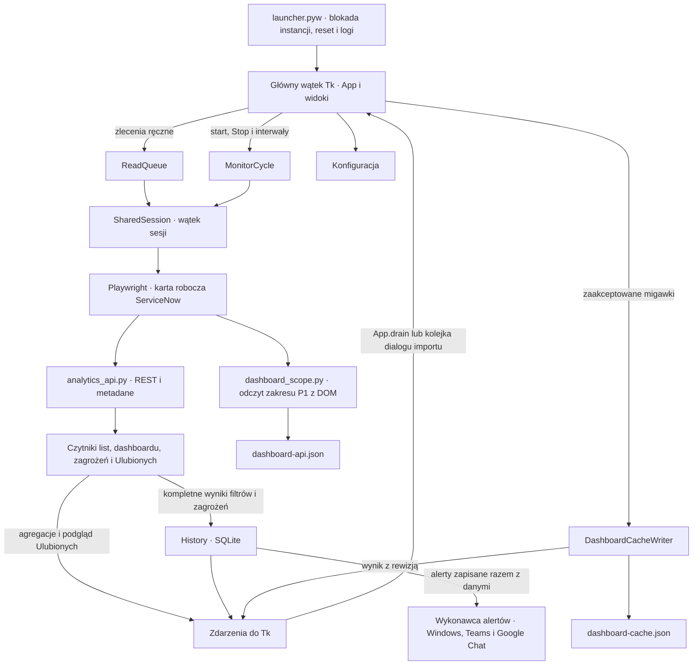

# Architektura Neto Incident Monitor

Ten dokument opisuje bieżące źródła. Historię paczek lokalnych, wydań publicznych i ich odbioru prowadzi [indeks wersji](wersje/README.md).

## Przepływ i odpowiedzialności

| Właściciel | Co wykonuje |
| --- | --- |
| **Główny wątek Tk** | `App` składa UI, przekazuje zlecenia, odbiera zdarzenia w `drain`, sprawdza aktualność wyników i zapisuje ustawienia. Przy odczycie dashboardu lub zagrożeń wątek sesji prosi Tk o przygotowanie żądania. Definicja filtra odkryta w sesji czeka na zatwierdzenie i zapis przez Tk. [App](../neto_incident_monitor/app.py) · [UI](../neto_incident_monitor/ui.py) |
| **Wątek sesji** | `SharedSession` jest właścicielem kontekstu i karty Playwright. `ReadQueue` szereguje i scala zlecenia ręczne. `MonitorCycle` wyznacza terminy dashboardu, zagrożeń SLA oraz partii INC i zgłoszeń katalogowych. `Schedule` budzi wątek przy zmianie pracy lub interwałów. [Sesja](../neto_incident_monitor/shared_session.py) · [Kolejka i harmonogram](../neto_incident_monitor/monitoring.py) |
| **Wykonawcy lokalni** | Wątek sesji zatwierdza migawki filtrów i zagrożeń w `History`. `history_writer` wykonuje operacje historii zlecane przez UI i porcjami czyści zakończone wpisy alertów. `alert_writer` obsługuje trwałą kolejkę dostarczenia. `DashboardCacheWriter` szereguje migawki widoku i ponawia atomową podmianę na swoim wątku. Ręczne testy kanałów korzystają z nadawców Teams i Google Chat. [Historia](../neto_incident_monitor/history.py) · [Retencja](../neto_incident_monitor/alert_retention.py) · [Cache dashboardu](../neto_incident_monitor/dashboard_cache.py) |

`launcher.pyw`, podgląd UI i próba offline paczki korzystają z tego samego konstruktora `App`. Konstruktor zawsze tworzy `SharedSession`, a `app.main()` uruchamia jej wątek. [Launcher](../launcher.pyw) · [Implementacja](../neto_incident_monitor/app.py) · [Testy wspólnej sesji](../tests/test_shared_session.py)

## Gdzie zacząć w kodzie

| Zadanie | Punkt wejścia i kontrakt |
| --- | --- |
| Start, zamykanie, reset | `launcher.main()` → `app.main()` → `data_validation.preflight()`. Blokada instancji chroni też wznawianie resetu. `startup.py` utrzymuje istniejący wpis autostartu Windows, a ustawienia nie udostępniają jego przełącznika. [Launcher](../launcher.pyw) · [Reset](../neto_incident_monitor/data_reset.py) · [Autostart](../neto_incident_monitor/startup.py) |
| Logowanie, Chromium, fokus | `SharedSession.authenticate()` wywołuje nawigację i pętlę z `browser_login.py`, a po potwierdzeniu sesji przekazuje gotowość Tk. `login_observation.py` rozpoznaje stan, `automatic_login.py` prowadzi akcje na formularzu, `browser_policy.py` steruje widocznością, a `window_style.py` fokusem monitora. Operacje okna Chromium są w `browser_actions.py`. [Sesja](../neto_incident_monitor/shared_session.py) · [Logowanie](../neto_incident_monitor/browser_login.py) · [Kontrakt logowania](kontrakty/diagnostyka-logowania.md) |
| Kolejka i statusy | `App.enqueue_refresh()` → `ReadQueue.submit()` → `SharedSession.next_part()` → `App.execute_session_part()` → zdarzenia do Tk. `SharedSession.prepare_analytics_read()` czeka na ID i kontekst żądania z Tk. Widoki dashboardu i zagrożeń odbierają zdarzenia przez własne funkcje. [Kontrakt kolejki](kontrakty/kolejka-i-trwalosc.md#kolejka-i-anulowanie) · [Decyzja 042](decyzje/042-granice-app-i-sesji.md) |
| Filtry INC, SCTASK, REQ i RITM | `App.read_filter()` używa zapisanej definicji i układu konta. `filter_metadata.py` oraz `filter_conditions.py` sprawdzają adres i warunki. `filter_definition.api_query()` przygotowuje zapytanie wspólnie dla walidacji i Table API. `filter_layouts.py` pobiera układ, a `filter_api.read_filter_records()` sprawdza kompletność odpowiedzi. Lokalną prezentacją kolumn zarządzają `dynamic_columns.py` i `table_loading.py`. [Przygotowanie zapytania](../neto_incident_monitor/filter_definition.py) · [Kontrakt list](kontrakty/kontrakt-odczytu-list.md) |
| Dashboard i zagrożenia SLA | `App` przekazuje zależności do `dashboard_read.py` i `threatened_read.py`. Pierwszy moduł czyta trzy sekcje przez `dashboard_api.py`. Drugi korzysta z `threatened_api.py` i po pełnym odczycie wywołuje zapis listy oraz podsumowania w SQLite. Osobny `dashboard_scope.refresh_scope()` pobiera przez DOM obie listy identyfikatorów z zapytania P1. [Dashboard](../neto_incident_monitor/dashboard_read.py) · [Zagrożenia](../neto_incident_monitor/threatened_read.py) · [Zakres](../neto_incident_monitor/dashboard_scope.py) |
| Import Ulubionych | `FavoritesImport` przekazuje zlecenie do sesji. `favorites_worker.read_on_session()` odczytuje drzewo przez `favorites_api.py`, a `favorites.commit_selection()` zapisuje wybrane filtry po potwierdzeniu w Tk. [Worker](../neto_incident_monitor/favorites_worker.py) · [Kontrakt importu](kontrakty/kontrakt-importu-ulubionych.md) |
| Transport i ponowienia | `analytics_api.py` wykonuje odczyty na zalogowanej karcie i klasyfikuje błędy HTTP. `section_runner.py` obsługuje ponowienia sekcji i odzyskiwanie sesji. `read_budget.py` ogranicza oczekiwania wewnątrz operacji. [Transport](../neto_incident_monitor/analytics_api.py) · [Integracja REST](servicenow-api-sesja-przegladarki.md) · [Budżety według operacji](kontrakty/kolejka-i-trwalosc.md#operacje-i-warunki-zatwierdzenia) |
| Historia, konfiguracja i alerty | `History.commit_filter()` i `commit_threatened()` zapisują stan oraz alerty w jednej transakcji. `App.deliver_alerts()` i nadawcy kanałów wykonują wysyłki. `config_io.py` obsługuje konfigurację i jej wcześniejsze formaty, a `secret_config.py` chroni webhooki przez DPAPI. [Historia](../neto_incident_monitor/history.py) · [Konfiguracja](../neto_incident_monitor/config_io.py) · [Kontrakt trwałości](kontrakty/kolejka-i-trwalosc.md#lokalne-dane-i-migracja) |
| Diagnostyka i weryfikacja | `login_diagnostics.py` rejestruje dozwolone pola z korelacją uruchomienia i operacji. `safe_logging.py` obsługuje błędy logowania i rotację. `tools/run_regression.py` uruchamia moduły testów na izolowanych danych. [Diagnostyka](../neto_incident_monitor/login_diagnostics.py) · [Runner](../tools/run_regression.py) · [Raporty odbioru](weryfikacja/README.md) |

## Zasady współpracy modułów

- Start potwierdza sesję przed udostępnieniem głównego okna. Po rozpoznaniu konta i przy brakującym zakresie dashboardu kolejka podejmuje próby odczytu układów INC, REQ, RITM i SCTASK, a następnie pobiera zakres. Zapisany komplet wystarcza przy kolejnym uruchomieniu. [Decyzja 040](decyzje/040-startowy-zakres-dashboardu.md) · [Odbiór](plany/zakonczone/startowy-odczyt-zakresu-dashboardu.md#4-testy-i-odbiór)
- Pełna aktualizacja obejmuje dashboard, zagrożenia i włączone filtry. Stop kończy cykl monitoringu. Ręczne zlecenia mogą działać w gotowej sesji bez aktywnego cyklu. [Kontrakt kolejki](kontrakty/kolejka-i-trwalosc.md#kolejka-i-anulowanie)
- `SharedSession` przekazuje do diagnostyki zagrożeń przyczynę oczekiwania na kartę po odczycie dashboardu lub filtra. Przejście do oczekiwania na następny termin ustawia przyczynę `idle`. [Harmonogram w kontrakcie kolejki](kontrakty/kolejka-i-trwalosc.md#kolejka-i-anulowanie)
- Główne okno Tk rejestruje odroczoną stylizację mapowanych dialogów. Jeżeli dialog zamknie się przed wykonaniem callbacku, stylizacja kończy się po sprawdzeniu istnienia okna. [Styl okien](../neto_incident_monitor/window_style.py) · [Test podglądu definicji filtra](../tests/test_shared_session.py)
- Dopasowanie kolumny mierzy szerokość fontem Tk. W dużej tabeli rozkłada pomiary na porcje z budżetem 6 ms. Dopasowanie podczas wczytywania czeka na pełną tabelę, a odświeżenie, zmiana układu lub opuszczenie widoku może je anulować. [Dopasowanie](../neto_incident_monitor/dynamic_columns.py) · [Decyzja 043](decyzje/043-plynnosc-tk.md)
- Dashboard dzieli dostępną wysokość między pięć rzędów o jednakowej wysokości po uwzględnieniu nagłówków, odstępów i stałej belki odczytu. Minimalną wysokość wyznacza zawartość kafelków. Poniżej tego progu widok przewija się w pionie. [Układ dashboardu](../neto_incident_monitor/dashboard_ui.py) · [Test zmiany rozmiaru](../tests/test_dashboard_snapshots.py)
- Liczniki na kartach filtrów korzystają z ostatnich przyjętych wyników. Tk zalicza wyświetlenie po pokazaniu aktualnego zestawu bieżących zgłoszeń i pamięta je osobno dla każdego filtra w bieżącym uruchomieniu. Przełącznik harmonogramu zachowuje ostatni wynik i stan jego wyświetlenia. [Decyzja 046](decyzje/046-liczniki-zgloszen-w-filtrach.md)
- Po trzech kolejnych błędach odczytu filtra sesja zleca Tk zapis wyłączenia przez istniejący mechanizm harmonogramu. [Decyzja 048](decyzje/048-wylaczenie-filtra-po-bledach.md)
- Walidator warunków może przekazać do `App.filter_condition_message()` nazwę pola związanego z błędem. App dobiera etykietę z dostępnego układu konta i przekazuje komunikat do istniejącej belki odczytu. [Kontrakt odczytu list](kontrakty/kontrakt-odczytu-list.md#table-api-w-bieżących-źródłach)
- Potwierdzone zero, błąd i częściowy wynik mają odrębne znaczenie. Rewizja filtra, generacja cyklu i konta oraz ID żądania chronią właściwy zapis i publikację. [Decyzja 003](decyzje/003-poprawnosc-i-aktualnosc.md) · [Decyzja 027](decyzje/027-zmiany-filtrow-podczas-monitoringu.md)
- Historia i liczniki zagrożeń SLA są dostępne po restarcie także wtedy, gdy baza nie zawiera jeszcze danych filtrów. Dopiero pierwszy kompletny zapis filtra tworzy tabele historii i obecności filtrów oraz ustawia wersję schematu na `1`. [Kontrakt trwałości](kontrakty/kolejka-i-trwalosc.md#lokalne-dane-i-migracja)
- EXE trzyma dane użytkownika i logi w `%LOCALAPPDATA%\NetoIncidentMonitor`. Uruchomienie ze źródeł używa `data/` dla danych i oddzielnego katalogu logów każdej kopii w `%LOCALAPPDATA%\NetoIncidentMonitor-SourceLogs`. PyInstaller osadza parametry analityki z jawnego wejścia o przypiętej rewizji i sumie kontrolnej. Zakres agentów i lokalizacji pochodzi z profilu użytkownika. [Ścieżki](../neto_incident_monitor/runtime_paths.py) · [Instrukcja budowy](budowa-exe.md) · [Logi źródeł](decyzje/045-logi-uruchomien-ze-zrodel.md)

## Decyzje i wcześniejsze odbiory

- Dawny odczyt przez DOM i jego odbiór zachowują [raport stabilizacji dashboardu](weryfikacja/odbior-stabilizacji-dashboardu.md), [raport ukrytego Chromium](weryfikacja/odbior-ukrytego-dashboardu.md) oraz [plan stabilizacji filtrów](plany/zakonczone/stabilizacja-odczytu-filtrow.md). Wdrożenie REST opisują [decyzje 033–038](decyzje/README.md) i [kontrakty](kontrakty/README.md).
- Poprawki logowania SSO, przekazania fokusu i renderowania mają własne [raporty odbioru](weryfikacja/README.md) oraz [decyzje](decyzje/README.md). Historyczne wyniki odnoszą się do wersji i środowiska podanych w tych dokumentach.
- Historię napraw lokalnego zapisu i diagnostyki zachowuje [audyt techniczny](archiwum/AUDIT.md). Bieżące ograniczenia i otwarte zadania prowadzi [indeks planów](plany/README.md).
